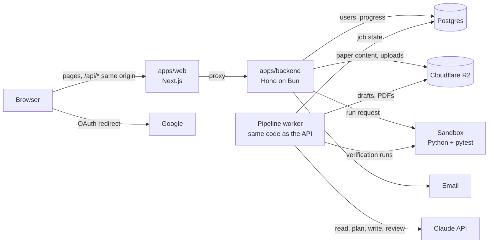

# 01 — Architecture

## 1. Goals

1. A learner can open a paper, read a step, write Python in the browser, and get a
   per-test verdict in a few seconds.
2. A maintainer can upload a paper and get verified learning steps without writing
   problems or tests by hand.
3. Everything is free. The code is open source and anyone can run their own instance.
4. Hidden tests and reference solutions never leave the server.
5. Running a stranger's code cannot harm the instance, other users, or third parties.
6. Solving steps produces visible progress: a profile, streaks, a leaderboard.
7. The hosted instance runs on serverless infrastructure; the same code runs as containers
   for self-hosters.

## 2. Non-goals

- Payments, plans, or any feature gated by money.
- Languages other than Python.
- GPU execution or long training runs. A run is seconds of CPU.
- Real-time collaboration.
- A native mobile app. The site must be usable on a phone, but the editor targets desktop.

## 3. Components



| Component           | Responsibility                                                                                        | Must not                                                    |
| ------------------- | ----------------------------------------------------------------------------------------------------- | ----------------------------------------------------------- |
| `apps/web`          | Render pages, host the editor and the admin screens, proxy `/api/*`                                   | Hold secrets or touch the database                          |
| `apps/backend`      | All business logic: auth, content, submissions, progress, admin                                       | Execute user or generated code in its own process           |
| Pipeline worker     | Runs paper-pipeline tasks and scheduled jobs                                                          | Publish anything on its own (spec 09 §1)                    |
| `packages/pipeline` | The pipeline's stages, prompts and checks                                                             | Call a vendor SDK directly; it uses the `LlmClient` adapter |
| `packages/runner`   | Turn "code + problem" into a structured result via a sandbox provider                                 | Know about users, HTTP or the database                      |
| `packages/content`  | Schemas for papers and problems; reading and writing them in storage; import from and export to files | Decide who may see what                                     |
| `packages/storage`  | The `ObjectStorage` interface with `r2` and `fs` drivers                                              | Know what the objects mean                                  |
| `packages/db`       | Schema, migrations, database client                                                                   | Contain business rules                                      |
| `packages/shared`   | Zod schemas, enums and constants used by both apps                                                    | Import anything server-only                                 |
| Sandbox             | Isolated, network-less, short-lived Python environment                                                | Receive any secret                                          |

The worker is not a separate codebase. On serverless hosting it is a set of internal
endpoints of the API; when self-hosted it is the API image started with a different
command (spec 09 §13).

## 4. Request paths

### 4.1 Reading a content page

```
browser ──▶ web (cached page) ──▶ on revalidation: GET /api/v1/papers/... ──▶ R2 (through the API's cache)
```

Catalogue, paper and problem pages are rendered on the server from the API's public
content endpoints and cached, with revalidation every 30 seconds. A newly published paper
appears within a minute, with no redeploy (the freshness budget is in spec 05 §4). Cached pages keep being served if the API is
briefly unavailable.

### 4.2 Any API call from the browser

```
browser ──▶ https://example.com/api/v1/progress
            Next.js rewrite
        ──▶ https://<api>/api/v1/progress ──▶ Hono
```

The browser never learns the API's own hostname. Consequences:

- The session cookie is first-party and `SameSite=Lax`. No cross-site cookie, no CORS.
- Preview deployments and self-hosted instances work with one environment variable.
- The Content-Security-Policy can use `connect-src 'self'`.

The cost is one extra hop per API request. Requests are short, so this is acceptable.
Server-side code in `apps/web` calls the API origin directly. Large uploads and downloads
use presigned storage URLs instead of the proxy.

### 4.3 Running code

```mermaid
sequenceDiagram
    participant B as Browser
    participant A as API
    participant D as Postgres
    participant S as Sandbox

    B->>A: POST /api/v1/submissions {paperId, problemId, code, mode}
    A->>D: insert submission (status=queued)
    A-->>B: 202 {id, status: "queued"}
    A->>S: create sandbox, write files, run harness
    loop every ~1 s
        B->>A: GET /api/v1/submissions/{id}
        A-->>B: {status: "running"}
    end
    S-->>A: result.json
    A->>D: store result; on first pass, record progress and stats
    B->>A: GET /api/v1/submissions/{id}
    A-->>B: {status: "completed", verdict, tests[]}
```

No request stays open longer than about a second. Details are in spec 07.

### 4.4 Turning a paper into steps

```
maintainer ──▶ upload PDF ──▶ ingestion row + first task
worker     ──▶ read & chunk ──▶ plan ──▶ write each step ──▶ verify in sandbox ──▶ draft
maintainer ──▶ review ──▶ publish ──▶ visible to learners
```

A queue of small restartable tasks in Postgres drives it. The full design is spec 09.

## 5. What we do differently from the reference, and why

| Reference behaviour                                       | Our design                                                                                       | Reason                                                       |
| --------------------------------------------------------- | ------------------------------------------------------------------------------------------------ | ------------------------------------------------------------ |
| Paid plans gate papers, tools and tracks                  | Everything free; no payment code                                                                 | The project's purpose                                        |
| Closed source, single hosted site                         | Open source, self-hostable                                                                       | The project's purpose                                        |
| Content authored privately by the site's owners           | AI pipeline with automated verification and human approval; shared library open to contributions | Scales beyond a handful of papers without hand-writing tests |
| Browser calls a second domain with a cross-site cookie    | Same-origin proxy                                                                                | Simpler cookies, no CORS                                     |
| One blocking request per run                              | Create then poll                                                                                 | No long-held connections                                     |
| Verdict is raw pytest text parsed by regex in the browser | Structured per-test JSON                                                                         | Stable contract, per-test detail                             |
| Editor content is lost on reload                          | Draft autosave; last submission restorable                                                       | Users lose work otherwise                                    |
| All data fetched client-side behind "Loading…"            | Server-rendered, cached content pages                                                            | Faster first paint, indexable                                |
| Interactive API docs public in production                 | Off in production                                                                                | Do not publish a map of the API                              |
| Quiz graded in the browser, score trusted                 | Server-graded attempts                                                                           | Scores feed statistics                                       |

Kept from the reference: the paper → steps model, the Run/Submit split, per-problem limits
and banned imports, profiles and leaderboard, and the surrounding tools.

## 6. Serverless constraints and how each is met

On the hosted instance the API runs as functions that start on demand, share no memory,
and may run many copies at once.

| Constraint                                      | Consequence                                                        | Design                                                                                      |
| ----------------------------------------------- | ------------------------------------------------------------------ | ------------------------------------------------------------------------------------------- |
| Cannot safely run untrusted processes           | Code execution must be elsewhere                                   | Sandbox per run (07)                                                                        |
| No shared memory between invocations            | In-memory rate limits are wrong; in-memory caches are per instance | Counters in Postgres (11); content cached per instance against immutable versions (03 §2.3) |
| No persistent disk                              | Content cannot be local files                                      | Content in R2 (03 §2)                                                                       |
| Function ends when the response is sent         | Background work would be killed                                    | `waitUntil` for a single run; stuck jobs are reaped (07 §3)                                 |
| No invocation can be assumed to survive minutes | The pipeline cannot be one long call                               | Queue of idempotent tasks with leases (09 §13)                                              |
| Many concurrent instances                       | Connection exhaustion on Postgres                                  | Transaction-mode pooler, small pool per instance (04 §1)                                    |
| Request body size limits                        | Large uploads fail                                                 | Presigned uploads for PDFs and video                                                        |
| Cold starts                                     | First request after idle is slow                                   | Cached content pages do not wait on the API; small bundle; heavy SDKs imported lazily       |

## 7. Two deployment modes

|                            | Hosted (serverless)                                      | Self-hosted (containers)        |
| -------------------------- | -------------------------------------------------------- | ------------------------------- |
| API entry                  | Default export of the Hono app on the host's Bun runtime | `Bun.serve`                     |
| Background work            | Internal endpoints + schedule                            | Worker process                  |
| Sandbox                    | Managed microVM                                          | Bundled Docker runner           |
| Storage                    | Cloudflare R2                                            | Local disk (`fs` driver), or R2 |
| Email, Google sign-in, LLM | Configured                                               | Optional                        |

To keep both working, **the Hono app MUST use only Web-standard APIs** (`Request`,
`Response`, `fetch`, Web Crypto). Bun-specific or host-specific calls are allowed only in:

- the entry files,
- `packages/runner` providers,
- the adapter modules (storage, email, LLM, background dispatch).

The hosted API is a Vercel project using Vercel's Bun runtime, selected by a `bunVersion`
setting in its `vercel.json`. Moving to another host means replacing the entry file and
adapters, not the routes. Self-hosting is specified in spec 13.

## 8. External services

Postgres and a storage location are required; storage can be a local directory. Everything
else is optional and switches its features off when absent (spec 13 §4).

| Purpose                                     | Hosted default   | Self-hosted default            | Adapter           | From   |
| ------------------------------------------- | ---------------- | ------------------------------ | ----------------- | ------ |
| Database                                    | Managed Postgres | Postgres container             | `packages/db`     | M0     |
| Sandbox                                     | Vercel Sandbox   | Bundled runner                 | `SandboxProvider` | M1, M4 |
| Email                                       | Resend           | None, or SMTP                  | `EmailSender`     | M3     |
| Sign-in                                     | Google OAuth     | None                           | Better Auth       | M3     |
| Object storage, including all paper content | Cloudflare R2    | Local disk                     | `ObjectStorage`   | M1     |
| LLM                                         | Claude API       | Claude API, operator's own key | `LlmClient`       | M6     |
| Speech                                      | Undecided        | None                           | `SpeechProvider`  | M10    |

## 9. Environments

| Environment | Web              | API              | Database            | Sandbox                       | LLM                              |
| ----------- | ---------------- | ---------------- | ------------------- | ----------------------------- | -------------------------------- |
| Local       | `localhost:3000` | `localhost:8797` | Postgres in Docker  | `local` provider (subprocess) | Fake by default; real with a key |
| Preview     | Preview deploy   | Preview deploy   | Separate database   | Real sandbox                  | Real, low limits                 |
| Production  | `example.com`    | Internal URL     | Production database | Real sandbox                  | Real                             |

Preview and production MUST NOT share a database.

## 10. Cross-cutting rules

- **The server is the only authority.** The UI may hide things; every rule about identity,
  role, limits and correctness is enforced in `apps/backend`.
- **One source for each fact.** Enums and payload shapes live in `packages/shared`. A
  problem's limits live on the problem.
- **Secrets stay in the API and worker.** The web app has no secret environment
  variables. The sandbox receives none at all.
- **Generated code is untrusted code.** Solutions and tests written by the model run only
  in the sandbox, exactly like a learner's submission.
- **Failures of our infrastructure are never blamed on the user.** A sandbox outage yields
  `internal_error`, which does not count against limits or statistics.
