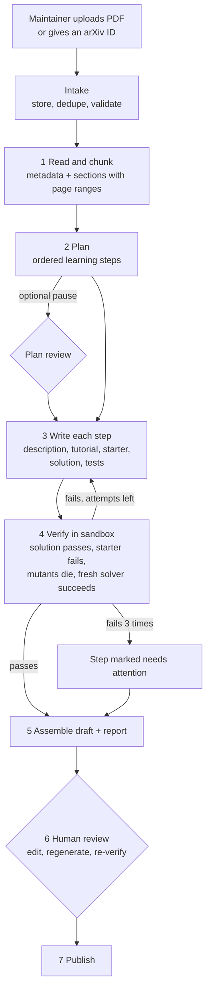

# 09 — Paper pipeline

How an uploaded paper becomes a set of published learning steps without anyone writing
problems or tests by hand.

A maintainer uploads a PDF. The pipeline reads it, splits it into chunks, plans a learning
path, writes every step (description, tutorial, starter code, reference solution, tests),
proves each step works by running it in the sandbox, and hands the maintainer a draft to
review and publish.

## 1. The guarantee

> **The AI writes. The sandbox verifies. A human approves.**

1. Everything a learner sees or is graded against is generated by the model, not typed by
   the uploader.
2. Nothing generated is trusted because the model says so. Every step must pass the
   automated checks in §8, which run real code in the same sandbox learners use.
3. Nothing is published until a maintainer clicks publish (§10). Self-hosters may turn on
   automatic publishing for their own instance; it is off by default.

## 2. Who can use it

| Role         | Can                                                         |
| ------------ | ----------------------------------------------------------- |
| `maintainer` | Upload papers, review, edit, regenerate, publish, unpublish |
| `admin`      | The same, plus manage roles and instance settings           |
| `user`       | Nothing here. Sees a paper only once it is published.       |

The pipeline is available when the instance has an LLM key configured
(spec 13 §4). Without them the upload screen explains what is missing.

## 3. Overview



Stages 1–5 are automatic. Stage 3 and 4 run per step, several steps at a time.

## 4. Intake

**Input.** One of:

- a PDF, at most 30 MB and 60 pages, uploaded by presigned URL straight to object storage;
- an arXiv identifier. The server downloads the PDF from arXiv's own host only. No other
  URL is ever fetched.

**Options** the maintainer may set, all optional:

| Option           | Default                     | Meaning                                                  |
| ---------------- | --------------------------- | -------------------------------------------------------- |
| `targetSteps`    | Chosen by the planner, 4–12 | Roughly how many steps                                   |
| `environment`    | Chosen per step             | Force `numpy` or `torch` for all steps                   |
| `focus`          | —                           | Free text: "only the attention mechanism, skip training" |
| `pauseAfterPlan` | `false`                     | Stop for plan review before writing                      |

**On submit.**

1. Check the file is really a PDF (signature bytes) and within limits.
2. Compute its SHA-256. If an ingestion or paper already exists for the same hash or
   arXiv ID, return it instead of starting a new one, unless `force` is set.
3. The maintainer confirms they may use the paper for this purpose.
4. Create the `ingestions` row and the first task. Respond `202 { id }`.

The PDF is stored in the private R2 bucket and is never served to learners. Published pages
link to the paper's own URL.

## 5. Stage 1 — Read and chunk

One model call with the whole PDF attached.

**Output** (structured):

```ts
type Outline = {
  title: string;
  authors: string[];
  year: number | null;
  url: string | null; // arXiv or DOI link if identifiable
  summary: string; // ≤ 300 characters, original wording
  tags: string[]; // from the controlled tag list
  chunks: {
    id: string; // "c01", "c02", ...
    heading: string; // the paper's own section title
    pageStart: number;
    pageEnd: number;
    summary: string; // what this part establishes
    equations: { label: string; latex: string; meaning: string }[];
    algorithms: string[]; // named procedures described here
    implementable: boolean; // can a learner code something from this?
  }[];
  suitability: { ok: boolean; reason: string };
};
```

- **Chunks follow the paper's logical structure** (sections and subsections), not fixed
  token windows. A chunk is the unit a learning step points back to.
- Chunks are stored in the ingestion's `outline.json`. The review screen shows them beside the
  steps they produced, with page numbers so the maintainer can check the source.
- `suitability.ok = false` stops the pipeline with the reason shown. Examples: a purely
  theoretical paper with nothing to implement, a survey, a scanned document the model
  cannot read, or a paper whose method needs hardware or data the sandbox does not have.

## 6. Stage 2 — Plan the learning path

One model call with the PDF and the outline.

**Output** (structured):

```ts
type Plan = {
  steps: {
    id: string; // slug, becomes the problem ID
    title: string;
    summary: string;
    concept: string; // the one idea this step teaches
    chunkIds: string[]; // where in the paper it comes from
    paperRefs: string[]; // "§3.2", "Eq. 1", "Algorithm 1"
    type: "micro" | "model";
    difficulty: "easy" | "medium" | "hard";
    environment: "numpy" | "torch";
    entryPoint: string; // function or class name
    signature: string; // Python signature with type hints
    allowedPackages: string[];
    prohibitedImports: string[];
    dependsOn: string[]; // earlier step IDs it builds on
  }[];
  omitted: { what: string; why: string }[];
};
```

**Rules the planner is given.**

- Order steps from primitives to composition. The last step is usually `type: "model"`:
  assemble the earlier pieces into the paper's method.
- One concept per step. A learner should finish a step in 10–40 minutes.
- Every step must be checkable by fast, deterministic unit tests on CPU with small inputs:
  no dataset downloads, no training to convergence, no GPU, no randomness without a seed.
- Prefer `numpy` unless the paper's point is something NumPy makes impractical.
- `prohibitedImports` must ban the library routine that would make the step trivial.
- Anything left out is listed in `omitted` with a reason, so the reviewer can see what the
  path does not cover.

If `pauseAfterPlan` is set, the ingestion waits in `awaiting_plan_review`. The maintainer
may reorder, rename, delete or add steps, then continue. Otherwise it continues at once.

## 7. Stage 3 — Write each step

One model call per step, with the PDF, the outline, the whole plan, and the signatures of
the steps it depends on.

**Output** (structured), one string per file:

| File          | Requirements                                                                                                                                                                                                                  |
| ------------- | ----------------------------------------------------------------------------------------------------------------------------------------------------------------------------------------------------------------------------- |
| `description` | Markdown. The task; the maths with every symbol defined; the function contract (arguments, return value, shapes, dtypes); one small worked example; common mistakes; where it is in the paper. Solvable from this text alone. |
| `tutorial`    | Markdown. Intuition and background for someone who has not read the paper.                                                                                                                                                    |
| `starter`     | Python. The signature, a docstring, `raise NotImplementedError`.                                                                                                                                                              |
| `solution`    | Python. A clear, correct reference implementation.                                                                                                                                                                            |
| `testsPublic` | Pytest. 2–6 tests covering the main behaviour.                                                                                                                                                                                |
| `testsHidden` | Pytest. At least 3 tests: edge cases, larger inputs, numerical checks.                                                                                                                                                        |
| `helpers`     | Python, optional. See below.                                                                                                                                                                                                  |

All files follow the conventions of spec 03 §5: tests import from `solution`, one behaviour
per test, test names that read as sentences, an assertion message written for the learner
on every assertion, seeded randomness.

**Writing rules.**

- Explanations are in the model's own words. Short quotations are allowed with a
  reference; reproducing passages or figures from the paper is not.
- Notation matches the paper's, so the learner can move between the two.
- No raw HTML in markdown.
- Expected values in tests are computed independently where possible (closed forms,
  hand-checkable small cases, invariants such as shapes, symmetry, or rows summing to 1),
  not by copying the reference solution's output.

**Steps that build on earlier steps.** Each problem is graded on its own, with only the
learner's code for that step. When a step needs an earlier step's function, the pipeline
writes a `helpers` file containing it. The sandbox makes it importable as `helpers`; the
description documents its interface; its source is not shown in the workspace, so later
steps do not give away earlier answers.

## 8. Stage 4 — Verify

Each step's files are checked in the sandbox, using the same images and limits as learner
submissions. A step is **verified** only when every blocking check passes.

| #   | Check                         | Passes when                                                                                                                                | Blocking             |
| --- | ----------------------------- | ------------------------------------------------------------------------------------------------------------------------------------------ | -------------------- |
| V1  | Well-formed                   | All files parse; `entryPoint` is defined in starter and solution; tests import from `solution`; metadata satisfies the schema; no raw HTML | Yes                  |
| V2  | Solution is correct           | Reference solution passes every public and hidden test                                                                                     | Yes                  |
| V3  | Starter is unsolved           | Starter fails the public tests                                                                                                             | Yes                  |
| V4  | Import policy                 | Solution obeys the step's own allowed and prohibited imports                                                                               | Yes                  |
| V5  | Fast enough                   | Every test finishes in under half the step's time limit                                                                                    | Yes                  |
| V6  | Deterministic                 | Three runs give identical per-test outcomes                                                                                                | Yes                  |
| V7  | Tests have teeth              | See below                                                                                                                                  | Yes                  |
| V8  | Solvable from the description | See below                                                                                                                                  | Yes                  |
| V9  | Faithful to the paper         | See below                                                                                                                                  | Blocking issues only |
| V10 | Test hygiene                  | Public and hidden counts in range; every assertion has a message; hidden messages do not print whole arrays                                | Yes                  |

**V7 — mutation check.** Passing a correct solution does not show that tests catch
incorrect ones. The model is asked for at least five _mutants_: plausible wrong
implementations, each with a one-line description of its bug (wrong axis, missing scale
factor, off-by-one, wrong dtype, mask applied after instead of before). Each mutant is run
against the tests. Every mutant must fail at least one test. A surviving mutant goes back
to the writer with the instruction to add a test that catches it. If the model judges a
survivor to be equivalent to the correct solution, it is not sent back but is flagged for
the reviewer.

**V8 — independent solve.** A fresh model call receives only what a learner receives: the
description, the starter, the limits, and the helpers' interface. It does not see the
solution or the tests. Its answer is run against all tests. On failure it gets one more
attempt, seeing only the failing test names and messages, which is exactly what a learner
sees. If it still fails, the description is under-specified or the tests demand something
unstated, and the step goes back to the writer with the evidence.

**V9 — fidelity review.** A separate model call compares the step with the paper and
returns issues, each `blocking` (the formula or algorithm contradicts the paper; text is
copied at length) or `note` (a simplification worth mentioning). Blocking issues go back
to the writer. Notes are shown to the reviewer.

### Repair loop

When a blocking check fails, the writer is called again with the previous files and the
failure evidence, and asked to change only what is needed. Verification then runs again
from V1.

- At most **3** write attempts per step.
- After the third failure the step is marked `needs_attention`. The pipeline continues
  with the other steps.
- Every attempt, with its evidence, is kept for the review screen.

## 9. Stage 5 — Assemble

When every step is `verified` or `needs_attention`:

1. Write the paper and its problems as **draft** objects in storage (spec 03 §2–3).
2. Write the ingestion report: per step, the result of each check, attempts used, mutants
   generated and killed, fidelity notes; and for the whole run, duration, model, prompt
   version, tokens and sandbox runs used.
3. Set the ingestion to `ready_for_review` and notify the uploader.

## 10. Stage 6 — Human review

The review screen shows, per step: the source chunks with page numbers, each generated
file in an editor, the verification results, and the fidelity notes.

The maintainer can:

| Action                        | Effect                                                                       |
| ----------------------------- | ---------------------------------------------------------------------------- |
| Edit any file                 | Saved as a candidate. The step becomes `edited` and must be re-verified.     |
| Re-verify                     | Runs V1–V6 and V10 on the candidate (seconds). "Full check" also runs V7–V9. |
| Regenerate a step with a note | Runs stages 3–4 again for that step, with the note added to the prompt       |
| Add a step                    | Describe it in a sentence; stages 3–4 run for it                             |
| Reorder, rename, delete steps | Immediate                                                                    |
| Edit paper metadata           | Immediate                                                                    |
| Publish                       | See §11                                                                      |
| Discard                       | Deletes the draft and its ingestion data                                     |

Editing is how a human's judgement gets in. The maintainer still never has to write a test
from nothing: they change what the model wrote, and the checks tell them if it still holds.

## 11. Stage 7 — Publish

A draft can be published when:

- it has at least 3 steps;
- every step included has passed V1–V6 and V10 **on its current content**; and
- every step has passed V7 and V8, or the maintainer has waived them for that step with a
  written reason, which is stored.

Steps marked `needs_attention` must be fixed or removed first.

Publishing writes the draft as version 1 in storage and commits it through `index.json`
(spec 03 §2.2), which sets the paper and its steps to `published`. Content pages pick it up within a
minute (spec 08 §1). Who published and when is stored on the paper.

A published paper can later be edited through the same review screen. Changes to a
published step are held as a candidate and applied only when verification passes, so
learners are never served unverified content.

## 12. States

**Ingestion**

```
queued → reading → planning → [awaiting_plan_review] → writing → ready_for_review → published
                      │                                    │
                      └────────────── failed ◀─────────────┘        cancelled (any time before publish)
```

`writing` covers stages 3 and 4. `failed` carries a reason and can be retried from the
failed stage.

**Step**

```
pending → writing → verifying → verified
              ▲          │
              └─ repair ─┘   (≤ 3 attempts) → needs_attention
verified → edited → verifying → verified
```

## 13. Execution engine

A run takes minutes and involves dozens of model calls. It cannot live inside one HTTP
request, and on serverless hosting no single invocation may be assumed to survive. So the
pipeline is a **queue of small, restartable tasks in Postgres**.

| Task kind  | Key     | Does                                           |
| ---------- | ------- | ---------------------------------------------- |
| `read`     | —       | Stage 1                                        |
| `plan`     | —       | Stage 2                                        |
| `write`    | step ID | Stage 3 for one step (first attempt or repair) |
| `verify`   | step ID | Stage 4 for one step                           |
| `assemble` | —       | Stage 5                                        |

Rules:

- A task is claimed with `select … for update skip locked`, given a 10-minute lease, and
  marked done in the same transaction that enqueues its successors.
- **Tasks are idempotent.** A task whose lease expired is simply run again. Results are
  stored under `(ingestion, kind, key, attempt)`, so a rerun overwrites rather than
  duplicates.
- A task that throws is retried with backoff, up to 3 times, then the ingestion is
  `failed` with the error.
- At most 3 tasks of one ingestion run at once, to stay inside LLM rate limits.

One function, `tick()`, claims and runs tasks. It is driven differently per deployment:

| Deployment  | What calls `tick()`                                                                                                                                                                                                     |
| ----------- | ----------------------------------------------------------------------------------------------------------------------------------------------------------------------------------------------------------------------- |
| Serverless  | An internal endpoint, called when tasks are enqueued and again by itself while work remains; plus a scheduled call every minute as a safety net. Each invocation stops claiming new tasks after 80% of its time budget. |
| Self-hosted | A long-running worker process (`bun run worker`) that polls every 2 seconds                                                                                                                                             |

The task handlers are identical in both.

## 14. LLM requirements

All model calls go through the `LlmClient` adapter (spec 02 §4), built on the official
`@anthropic-ai/sdk`. **Read the SDK documentation before writing these calls; do not guess
method or parameter names.**

| Requirement         | Detail                                                                                                                                                                                                                                |
| ------------------- | ------------------------------------------------------------------------------------------------------------------------------------------------------------------------------------------------------------------------------------- |
| Model               | `claude-opus-5-5`, set by `LLM_MODEL`                                                                                                                                                                                                 |
| Reading the PDF     | Upload the PDF once through the Files API and reference it in each call as a document block. The model reads text, equations and figures directly; no separate PDF parser is needed.                                                  |
| Prompt caching      | The system prompt and the PDF are the same in every call of a run. Put them first and mark them cacheable with a one-hour lifetime, so later calls pay a fraction for them. Nothing that varies per call may precede the cached part. |
| Structured output   | Stages 1–3 and the V7 and V9 calls constrain the response to a JSON schema and validate it again with zod before use                                                                                                                  |
| Streaming           | Stage 3 produces long output; stream it and take the final message                                                                                                                                                                    |
| Thinking and effort | Leave adaptive thinking on. Set effort explicitly: high for planning, writing and repair; lower for mutant generation and fidelity review.                                                                                            |
| Stop reasons        | Check before reading content. `max_tokens` or `refusal` fails the task, which is then retried or surfaced. Enable the server-side refusal fallback option by default.                                                                 |
| Errors              | Use the SDK's typed errors. Retry rate-limit and overload errors with backoff; do not retry bad requests.                                                                                                                             |
| Accounting          | Record input, output and cache-read tokens for every call against the ingestion                                                                                                                                                       |
| Independence        | The V8 solver call shares no conversation with the writer and is given no solution or tests                                                                                                                                           |

This is a **fixed workflow orchestrated by our code**, not an autonomous agent. The stages
and the verify-repair loop are known in advance, verification must run in our own sandbox
images, and self-hosters must be able to run the whole thing with only an API key.

**Prompts** are files in `packages/pipeline/prompts/`, one per stage, versioned with a
`PROMPT_VERSION` constant recorded on every ingestion. Changing a prompt is a code change
with a review and an eval run (§18).

## 15. Data model

Everything the pipeline reads or writes that is _content_ is an object in storage. The
database holds only the state needed to run and resume the job.

### Objects

```
ingestions/<ingestionId>/
  source.pdf                         the uploaded paper
  outline.json                       stage 1 output, including every chunk
  plan.json                          stage 2 output, as edited by the maintainer
  steps/<stepId>/attempt-<n>.json    files written on attempt n, with the evidence from its checks
  steps/<stepId>/current.json        the step's files as they stand, generated or edited
  report.json                        stage 5 output
```

At assemble (§9) the step files are combined into the paper's draft objects,
`content/papers/<paperId>/draft/public.json` and `private.json`. At publish (§11) the
draft becomes `v1` and `content/index.json` is updated. Both layouts are in spec 03 §2.

Discarding a draft deletes its `ingestions/<id>/` and `draft/` objects.

### Tables

```sql
create table ingestions (
  id             uuid primary key,
  status         text not null,              -- §12
  source_type    text not null check (source_type in ('pdf','arxiv')),
  source_ref     text,                       -- arXiv ID, when given
  pdf_sha256     text not null,
  options        jsonb not null default '{}',
  paper_id       text,                       -- set at assemble
  model          text not null,
  prompt_version text not null,
  usage          jsonb not null default '{}',-- tokens, sandbox runs
  error          text,
  created_by     text not null references "user"(id),
  created_at     timestamptz not null default now(),
  updated_at     timestamptz not null default now(),
  finished_at    timestamptz
);
create unique index ingestions_one_per_pdf on ingestions (pdf_sha256)
  where status not in ('failed','cancelled');

create table ingestion_steps (
  ingestion_id uuid not null references ingestions(id) on delete cascade,
  step_id      text not null,
  position     integer not null,
  title        text not null,
  status       text not null,                -- §12
  attempts     integer not null default 0,
  verification jsonb,                        -- pass/fail and a one-line reason per check
  waivers      jsonb not null default '[]',  -- {check, reason, by, at}
  primary key (ingestion_id, step_id)
);

create table pipeline_tasks (
  id           uuid primary key,
  ingestion_id uuid not null references ingestions(id) on delete cascade,
  kind         text not null,
  key          text not null default '',
  status       text not null default 'pending'
                 check (status in ('pending','running','done','failed')),
  attempts     integer not null default 0,
  run_after    timestamptz not null default now(),
  lease_until  timestamptz,
  error        text,
  created_at   timestamptz not null default now(),
  updated_at   timestamptz not null default now()
);
create index pipeline_tasks_runnable on pipeline_tasks (run_after)
  where status in ('pending','running');
```

A task writes its objects first and marks itself done second. A task that is rerun
overwrites the same keys, which is why reruns are harmless.

## 16. Interfaces

**HTTP** — all under `/api/v1/admin`, all requiring `maintainer`.

| Method and path                                 | Purpose                                                    |
| ----------------------------------------------- | ---------------------------------------------------------- |
| `POST /ingestions/upload-url`                   | `{ filename, size }` → presigned upload URL and key        |
| `POST /ingestions`                              | `{ pdfKey }` or `{ arxivId }`, plus options → `202 { id }` |
| `GET /ingestions`                               | List with status and progress                              |
| `GET /ingestions/:id`                           | Status, outline, plan, per-step state, report, usage       |
| `PUT /ingestions/:id/plan`                      | Save an edited plan and continue (when paused)             |
| `PUT /ingestions/:id/steps/:stepId`             | Save edited files as a candidate                           |
| `POST /ingestions/:id/steps/:stepId/verify`     | `{ full: boolean }` → re-verify                            |
| `POST /ingestions/:id/steps/:stepId/regenerate` | `{ note }`                                                 |
| `POST /ingestions/:id/steps`                    | `{ description }` → add a step                             |
| `DELETE /ingestions/:id/steps/:stepId`          | Remove a step                                              |
| `POST /ingestions/:id/steps/:stepId/waive`      | `{ check: "V7" \| "V8", reason }`                          |
| `POST /ingestions/:id/publish`                  | Publish (§11)                                              |
| `POST /ingestions/:id/cancel`, `/retry`         | Stop, or resume from the failed stage                      |
| `DELETE /ingestions/:id`                        | Discard an unpublished draft                               |

Progress is read by polling `GET /ingestions/:id` every few seconds.

**Command line** — for self-hosters and automation.

```
bun run paper:ingest ./attention.pdf            # or: arxiv:1706.03762
bun run paper:ingest ./attention.pdf --focus "attention only" --pause-after-plan
bun run paper:status <ingestion-id>
bun run paper:publish <ingestion-id>
bun run content:export <paper-id>               # write the paper to content/ as files
```

`content:export` turns a pipeline-made paper into the file format of spec 03, so it can be
contributed to the project's shared library by pull request.

## 17. Screens

| Route                           | Shows                                                     |
| ------------------------------- | --------------------------------------------------------- |
| `/admin/papers`                 | Published papers, drafts, and ingestions in progress      |
| `/admin/papers/new`             | Upload or arXiv ID, options, the rights confirmation      |
| `/admin/ingestions/[id]`        | Live progress: stage, per-step status, tokens used so far |
| `/admin/ingestions/[id]/plan`   | The plan editor, when paused                              |
| `/admin/ingestions/[id]/review` | The review screen of §10                                  |

## 18. Limits, cost and quality

**Limits** (instance settings with defaults):

| Setting                           | Default                                                                                                 |
| --------------------------------- | ------------------------------------------------------------------------------------------------------- |
| PDF size / pages                  | 30 MB / 60                                                                                              |
| Steps per paper                   | 4–12                                                                                                    |
| Write attempts per step           | 3                                                                                                       |
| Concurrent ingestions             | 2                                                                                                       |
| Ingestions per maintainer per day | 10                                                                                                      |
| Output-token budget per ingestion | A fixed ceiling; when exceeded the ingestion fails with a clear message rather than continuing to spend |

A run makes on the order of tens of model calls and around a hundred short sandbox runs.
Actual tokens and runs are recorded per ingestion and shown on the report, so an operator
learns the real cost of a paper on their own instance from the first run.

**Measuring quality.** The project keeps a small set of reference papers with
hand-reviewed steps. An eval script runs the pipeline on them and reports:

| Measure                             | Meaning                                      |
| ----------------------------------- | -------------------------------------------- |
| First-attempt verification rate     | Share of steps verified without repair       |
| Needs-attention rate                | Share of steps the pipeline could not finish |
| Mutation kill rate at first attempt | How strong the first draft of tests is       |
| Independent-solve rate              | How clear the first draft of descriptions is |
| Reviewer edits before publish       | How much human work remains                  |
| Tokens per published step           | Cost                                         |

The eval is run before merging any change to prompts, model, or the checks. It spends real
money, so it is started by a person, not by every pull request.

## 19. Safety

| Risk                                                                   | Handling                                                                                                                                                                          |
| ---------------------------------------------------------------------- | --------------------------------------------------------------------------------------------------------------------------------------------------------------------------------- |
| The PDF contains text aimed at the model ("ignore your instructions…") | The system prompt states that the document is material to teach from, not instructions. More importantly, nothing the model produces is acted on without verification and review. |
| Generated code is malicious or broken                                  | It only ever runs inside the sandbox, with no network and no secrets, like learner code                                                                                           |
| Generated markdown carries script                                      | Raw HTML is rejected at V1 and never rendered (spec 08 §7)                                                                                                                        |
| Copyright                                                              | PDFs are stored privately and not redistributed; explanations are original; pages link to the paper; the uploader confirms the right to use it                                    |
| Runaway cost                                                           | Token budget per ingestion, daily limits per maintainer, a cap on concurrent ingestions                                                                                           |
| Wrong mathematics presented as fact                                    | V9, the visible fidelity notes, the page-referenced chunks beside each step, and the human publish gate                                                                           |
| A learner is graded by a wrong test                                    | V2, V7 and V8 together; plus a "report a problem" link on every step that reaches the maintainers                                                                                 |

## 20. Out of scope

- Sources other than PDF papers.
- Reproducing a paper's figures, datasets or benchmark numbers.
- Steps that need GPUs, large downloads or long training.
- Fully automatic publishing on the public instance.
- Generating quiz questions or courses from a paper. Likely later; the same engine applies.

## 21. Acceptance checks

- Uploading a well-known paper produces, with no manual writing, a draft of at least four
  steps in which every verified step passes V1–V10.
- Deliberately breaking a generated test in the review screen blocks publishing until it
  is fixed and re-verified.
- A step whose tests would accept a wrong implementation is caught by V7 and repaired or
  flagged; this is demonstrated with a planted weak test.
- A description that omits a requirement the tests enforce is caught by V8; demonstrated
  with a planted omission.
- Killing the worker or function mid-run and restarting it completes the ingestion with no
  duplicated steps.
- Uploading the same PDF twice returns the existing ingestion.
- A PDF that is not a paper, or has nothing implementable, ends in `failed` with a reason
  a maintainer can understand.
- No learner-facing response ever contains a solution, a test file, or helper source.
- The whole flow works on a self-hosted instance using only the command line.
